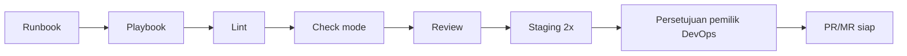

# DevOps-Agent-Workflow

Tim agen AI (Claude Code) yang mengerjakan **tiket Jira infrastruktur** dari **Todo sampai Ready To Review**: mengecek tiket, menulis runbook, menulis playbook Ansible, mengujinya di staging, meminta persetujuan, lalu membuat PR/MR.

Kamu cukup mengetik satu perintah, misalnya `/develop-tiket OPS-1234`. Agen bekerja; kamu memeriksa hasil dan menyetujui.

> **Dua janji utama**
> 1. **Dokumen dulu, baru kode.** Runbook (panduan langkah demi langkah) selalu ditulis sebelum playbook.
> 2. **Agen tidak pernah menyentuh production.** Agen hanya menguji di staging dan menyiapkan rilis. Yang menerapkan ke production selalu manusia atau pipeline. Pagar keamanan (`hooks/guard.sh`) memblokir pelanggaran secara otomatis.

Status: **v1**, siap dicoba di tiket nyata. Contoh alatnya Ansible; alat lain bisa dipakai dengan mengganti beberapa skill ([alat](docs/alat.md)).

---

## Daftar isi
1. [Cara kerjanya dalam satu gambar](#cara-kerjanya-dalam-satu-gambar)
2. [Persiapan pertama kali](#persiapan-pertama-kali) (sekali saja, ±15 menit)
3. [Perintah sehari-hari](#perintah-sehari-hari)
4. [Apa yang perlu kamu lakukan sebagai manusia](#apa-yang-perlu-kamu-lakukan-sebagai-manusia)
5. [Istilah penting](#istilah-penting)
6. [Pertanyaan umum](#pertanyaan-umum)
7. [Panduan lengkap](#panduan-lengkap) dan [isi repo](#isi-repo)

---

## Cara kerjanya dalam satu gambar


Di dalam `/develop-tiket`, urutannya selalu sama:



Kalau ada yang tidak cocok (runbook beda dengan playbook, uji staging gagal, run kedua masih mengubah sesuatu), pekerjaan kembali ke langkah sebelumnya. Kolom **Done** hanya dipindah manusia.

---

## Persiapan pertama kali

**1. Pasang alat** (macOS pakai `brew`; Linux pakai paket distro atau `pipx`):
```bash
brew install jq gh glab
pipx install --include-deps ansible
pipx install ansible-lint
# opsional, untuk menguji role di container:
pipx install molecule && pipx inject molecule "molecule-plugins[docker]"
```
Kamu juga butuh **Claude Code**. Orca dan Docker opsional.

**2. Sambungkan akun**
- Di claude.ai, hubungkan konektor **Atlassian** (Jira).
- Login CLI: `gh auth login` (GitHub) atau `glab auth login` (GitLab).
- Pastikan bisa SSH ke host **staging**. Akses production **tidak** dibutuhkan.

**3. Pasang workflow ini**
```bash
git clone https://github.com/roiskhoiron/DevOps-Agent-Workflow ~/devops-agent-workflow
bash ~/devops-agent-workflow/install.sh
bash ~/devops-agent-workflow/tests/run.sh    # harus keluar "ALL PASS"
```

**4. (Opsional) Aktifkan mode tim.** Supaya tiap agen tampil di panel sendiri: jalankan `claude --teammate-mode auto`, atau ketik `/config` → **Teammate mode** → `auto`.

**5. Jawab beberapa pertanyaan saat pertama dipakai.** Saat perintah pertama dijalankan di project baru, agen akan bertanya sekali saja lalu mengingatnya:

| Agen akan bertanya | Contoh jawaban |
|---|---|
| ID status Jira untuk Todo / In Progress / Ready To Review | pilih dari tabel yang ditampilkan agen |
| Inventory mana yang staging dan mana yang production | `inventories/staging`, `inventories/production` |
| Branch production dan branch integrasi | `master`, `develop` |
| Lokasi file password Vault **staging** | `~/.ansible/vault-pass-staging` |
| Siapa pemilik DevOps yang menyetujui tiket | nama orangnya |
| Siapa/apa yang menerapkan ke production | "Mas Budi" atau "pipeline deploy.yml" |

> Workflow Mobile sudah terpasang di komputer yang sama? Nama perintahnya sama, jadi installer akan berhenti dan menampilkan daftar bentrok. Satu komputer = satu workflow. Pakai `install.sh --force` bila komputer ini untuk DevOps.

Detail: [docs/pasang.md](docs/pasang.md).

---

## Perintah sehari-hari

Ketik di Claude Code:

| Kapan | Perintah | Hasilnya |
| --- | --- | --- |
| Ada tiket baru di Todo | `/validate-tiket OPS-1234` | Laporan kelayakan + komentar Jira; tiket pindah ke In Progress bila layak |
| Tiket siap dikerjakan | `/develop-tiket OPS-1234` | Runbook, playbook, hasil uji staging, PR/MR; tiket ke Ready To Review |
| Ada feedback dari reviewer/QA | `/rilis-tiket OPS-1234` | Tiket dikembalikan ke Todo, diuji ulang, atau PR-nya di-merge (setelah kamu bilang "ya") |
| Mau rilis versi baru | `/branch-manager --rilis OPS-1400` | Daftar perubahan, cek staging, runbook production, PR rilis. Agen **berhenti** di sini sampai manusia menerapkan |
| Ada keluhan, belum jadi tiket | `/audit-issue "nginx 502 di web-2 sejak pagi"` | Laporan penelusuran (hanya membaca, tidak mengubah apa pun) + saran tiket |

**Pilihan tambahan (flag):**

| Flag | Artinya |
| --- | --- |
| `--solo` | Satu agen mengerjakan semuanya (cocok untuk tiket kecil) |
| `--tim` | Dibagi ke beberapa agen: perencana, programmer, reviewer, QA, release |
| `--batch` (default) | Beberapa tiket digabung dan diuji di staging sekali jalan |
| `--separate` | Tiap tiket diuji sendiri-sendiri |
| `--uat` | Setelah lulus uji, pemilik DevOps memeriksa sendiri hasilnya di staging |

Tanpa flag, agen memilih sendiri yang paling masuk akal.

Contoh:
```text
/validate-tiket OPS-1234
/develop-tiket OPS-1234 OPS-1240 --tim
/develop-tiket OPS-1300 --solo --separate --uat
/audit-issue "disk penuh di db-stg-1" --solo
/branch-manager --rilis OPS-1400
```

Skill pendukung yang juga bisa dipanggil sendiri: `/inventory-check`, `/write-runbook`, `/write-playbook`, `/lint-playbook`, `/playbook-check`, `/apply-staging`, `/verify-idempotent`, `/request-approval`, `/finalize-runbook`, `/verify-live`, `/read-logs`. Penjelasan tiap skill: [docs/alur-kerja.md](docs/alur-kerja.md).

---

## Apa yang perlu kamu lakukan sebagai manusia

Agen akan **berhenti dan bertanya** kepadamu pada saat-saat ini. Cukup jawab di chat.

| Saat | Yang kamu lakukan |
| --- | --- |
| Perubahan menghapus data, me-restart layanan, atau mengubah firewall/hak akses | Jawab "lanjut" atau "stop" sebelum agen mengujinya di staging |
| Tiket selesai diuji | Pemilik DevOps membalas ringkasan dengan **"setuju"** atau **"tolak + alasan"**. Tanpa ini, PR/MR tetap Draft |
| Mau merge PR tiket / memindah tiket ke Todo | Jawab "ya" |
| PR rilis siap | Pilih **Konfirmasi / Tolak / Ikuti rekomendasi agen** |
| Setelah konfirmasi rilis | **Manusia** merge PR rilis dan menerapkan ke production (atau menjalankan pipeline), lalu jalankan `/branch-manager --rilis KODE` lagi supaya agen memverifikasi dan membuat tag |
| Memindah tiket ke Done | Selalu manusia |

---

## Istilah penting

| Istilah | Penjelasan sederhana |
| --- | --- |
| **Runbook** | Panduan perubahan di `docs/runbooks/`: tujuan, server yang terdampak, langkah, cara cek berhasil, cara membatalkan. Ditulis **sebelum** playbook |
| **Playbook** | Skrip Ansible yang menjalankan langkah-langkah runbook. Satu langkah = satu task dengan nama yang sama |
| **Staging / production** | Staging = server uji, boleh diubah agen. Production = server sungguhan, agen hanya boleh membaca |
| **Inventory** | Daftar server per lingkungan (staging, production) |
| **Check mode** | Menjalankan playbook "pura-pura": hanya menampilkan apa yang *akan* berubah |
| **Idempoten** | Dijalankan dua kali hasilnya sama. Agen selalu menjalankan dua kali; run kedua harus tanpa perubahan (`changed=0`) |
| **Kunci staging** | Satu server staging dipakai satu agen pada satu waktu, supaya hasil uji tidak tercampur |
| **Pemilik DevOps** | Orang yang menyetujui setiap tiket sebelum PR/MR siap direview |
| **Guard** | Pagar otomatis yang memblokir perintah berbahaya sebelum dijalankan |
| **SPV** | Agen "mandor": membagi tugas ke agen lain dan memutuskan tiket selesai |
| **origin / upstream** | `origin` = fork kita (agen boleh push); `upstream` = repo utama (hanya lewat PR/MR) |

---

## Pertanyaan umum

**Apakah agen bisa merusak production?**
Tidak lewat jalur normal. Guard memblokir playbook, Vault, dan perintah tulis ke inventory production, serta memblokir pemicuan pipeline. Agar benar-benar aman, **jangan simpan kunci SSH production** di komputer tempat agen berjalan (guard tidak bisa memeriksa `ssh` langsung).

**Muncul pesan "DIBLOKIR oleh guard".**
Itu berarti pagar bekerja. Baca pesannya; biasanya sudah menyebut cara yang benar. Daftar pesan umum: [docs/masalah-umum.md](docs/masalah-umum.md).

**Di mana hasil kerja agen?**
Di repo infrastruktur: `docs/runbooks/` (runbook), `docs/tickets/<KODE>/validasi.md` dan `uji.md` (laporan), ditambah PR/MR dan komentar Jira. Link laporan selalu ada di baris pertama komentar Jira.

**Rahasia (password, token) aman?**
Agen hanya memakai Vault **staging**. Semua keluaran disaring `bin/redact.sh` sebelum ditulis ke dokumen, Jira, atau PR.

**Tim kami tidak pakai Ansible.**
Kerangkanya tetap; ganti skill khas Ansible dengan padanannya (contoh Terraform di [docs/alat.md](docs/alat.md)).

---

## Panduan lengkap

| Halaman | Isinya |
| --- | --- |
| [Alur kerja](docs/alur-kerja.md) | Papan kanban, empat skill flow dan semua skill set-nya |
| [Documentation first](docs/documentation-first.md) | Cara menulis runbook dan menghubungkannya dengan playbook |
| [Tim agen](docs/tim-agen.md) | Peran, nama, model, dan larangan tiap agen |
| [Pagar keamanan](docs/pagar-keamanan.md) | Semua yang diblokir guard dan kapan agen bertanya |
| [Alat dan MCP](docs/alat.md) | Skrip `bin/`, perintah Ansible, konektor, pembersihan otomatis |
| [Pasang](docs/pasang.md) | Instalasi lengkap dan file yang dibuat per komputer |
| [Masalah umum](docs/masalah-umum.md) | Arti pesan error dan cara mengatasinya |
| [Rancangan](docs/design-summary.md) | Ringkasan draft, perbedaan dengan Mobile, keputusan implementasi, pertanyaan terbuka |

## Isi repo

| Folder | Isi |
| --- | --- |
| `skills/` | Langkah tiap perintah (`<perintah>/SKILL.md`) dan aturan bersama (`_shared/`) |
| `agents/` | Peran tiap agen |
| `hooks/guard.sh` | Pagar keamanan |
| `bin/` | Skrip pembantu: `lock.sh`, `runbook-check.py`, `recap-check.sh`, `redact.sh`, `risky-scan.sh`, `release-trace.sh`, `audit-mode.sh`, `housekeeping.sh` |
| `templates/` | Kerangka runbook dan ADR |
| `tests/` | Tes otomatis: `bash tests/run.sh` (juga jalan di GitHub Actions) |
| `docs/` | Panduan untuk pemula |

## Merawat dokumen ini
Setiap perubahan workflow atau alat **wajib** memperbarui README atau halaman `docs/` yang sesuai di commit yang sama. `tests/readme_test.sh` gagal bila ada perintah, skrip `bin/`, atau konektor yang belum disebut di dokumen.
