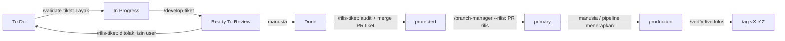
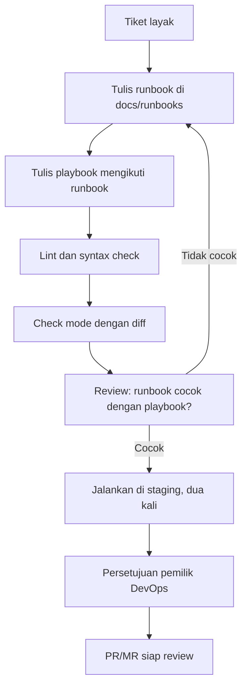

# Alur kerja

## Papan kanban
Papannya sama di platform apa pun (Jira, GitHub Projects, GitLab issue board, atau manual). Platform tidak punya default: agen menanyakannya saat pertama dipakai ([ticket-platform.md](../skills/_shared/ticket-platform.md)).
Sama dengan workflow Mobile: Todo → In Progress → Ready To Review → Done. Kolom Done hanya disentuh manusia.

| | To Do | In Progress | Ready To Review | Done |
| --- | --- | --- | --- | --- |
| **Artinya** | Tiket baru, belum dicek | Layak dan sedang dikerjakan | Runbook + playbook lolos staging dan disetujui pemilik DevOps, menunggu review manusia | Diterima |
| **Perintah** | `/validate-tiket` | `/develop-tiket` | `/rilis-tiket` (feedback) | `/rilis-tiket` (merge PR tiket), `/branch-manager --rilis` (rilis versi) |
| **Pindah oleh** | manusia; atau agen (`/rilis-tiket`, izin user) bila ditolak | agen (Validator), bila **Layak** | agen (Release), setelah persetujuan pemilik DevOps | **manusia saja** |
| **Bukti** | — | `docs/tickets/<KODE>/validasi.md` + komentar tiket | runbook, `uji.md`, PR/MR, komentar tiket | — |

## Empat skill flow dan skill set-nya
| Skill flow | Skill set, berurutan |
| --- | --- |
| `/validate-tiket` | `/setup-board`, `/setup-docs`, `/read-ticket`, `/sync-docs`, `/inventory-check`, `/find-related`, `/write-report`, `/post-decision` |
| `/develop-tiket` | `/gate-validation`, `/setup-worktree`, `/write-runbook`, `/write-playbook`, `/lint-playbook`, `/playbook-check`, `/review-code`, `/apply-staging`, `/verify-idempotent`, `/request-approval`, `/open-pr`, `/post-summary`, `/move-ticket` |
| `/rilis-tiket` dan `/branch-manager --rilis` | `/read-feedback`, `/audit-pr`, `/release-trace`, `/finalize-runbook`, `/prepare-release-pr`, `/verify-live`, `/tag-release` |
| `/audit-issue` | `/split-questions`, `/trace-code`, `/read-logs`, `/inventory-check`, `/write-report` |

Skill set yang **khas DevOps** (sebelas) adalah skill sendiri di `skills/<nama>/SKILL.md` dan bisa dipanggil langsung: `/inventory-check`, `/write-runbook`, `/write-playbook`, `/lint-playbook`, `/playbook-check`, `/apply-staging`, `/verify-idempotent`, `/request-approval`, `/finalize-runbook`, `/verify-live`, `/read-logs`. Skill set bersama (sama dengan role lain) adalah langkah bernama di dalam `SKILL.md` flow-nya.

## Documentation first
Setiap perubahan infrastruktur dimulai dari dokumen, bukan dari playbook. Lengkapnya: [documentation-first.md](documentation-first.md).

## `/validate-tiket`
1. Baca tiket, cek jejak pengerjaan (validasi ulang bila ditolak).
2. Sinkron dokumen (`docs/runbooks`, `docs/adr`, inventory) dari `upstream/<protected>`.
3. `/inventory-check`: permintaan vs inventory vs dokumen vs host nyata (modul baca saja). Bug → bukti dari `/read-logs`.
4. `/find-related`: tiket/PR terkait, kunci staging.
5. Laporan `docs/tickets/<KODE>/validasi.md` (di branch tiket, di-push ke fork), komentar tiket, In Progress bila layak.

`--tim`: HoE (repo vs dokumen, dampak host), PjM (ketergantungan), Spesialis eskalasi (hanya saat pemicu).

## `/develop-tiket`
| Flag | Artinya |
| --- | --- |
| `--solo` / `--tim` | satu agen, atau Planner + Coder + Reviewer + QA + Release sebagai teammate |
| `--batch` (default) | semua tiket satu branch batch, **satu rangkaian staging** |
| `--separate` | tiap tiket apply staging sendiri (tetap antre kunci staging) |
| `--uat` | sesudah QA lulus, pemilik DevOps memeriksa sendiri hasil di staging; SPV memegang kunci `human-<KODE>` sampai kamu bilang "selesai UAT" |

Urutan: gerbang validasi → worktree + **Peta host** → rencana + Draft PR/MR → **runbook** (dicocokkan SPV) → playbook → lint → check mode → review (runbook ↔ playbook, keamanan, idempotensi) → `risky-scan.sh` (berisiko → tanya kamu) → apply staging + Verifikasi → run kedua `changed=0` → **persetujuan pemilik DevOps** → `uji.md` → PR/MR siap → komentar tiket → Ready To Review.

## `/rilis-tiket`
| Keadaan | Tindakan |
| --- | --- |
| Ditolak | ringkas arahan, minta izin, tiket ke **Todo** |
| Diminta uji ulang di staging | apply staging + run kedua lagi, perbarui `uji.md` |
| Done + punya PR/MR | audit (approved, CI, runbook cocok, persetujuan tercatat) lalu merge PR tiket ke `<protected>` setelah "ya" |
| Tanpa feedback | lapor saja |

## `/branch-manager --rilis`
1. `release-trace.sh` melacak tiap commit `<primary>..<protected>` ke PR, tiket, programmer, dan runbook.
2. **Cek staging di `<sha-rilis>`**: check mode tiap playbook rilis, harusnya `changed=0`; selisih = drift.
3. `/finalize-runbook`: bagian Production tiap runbook (jendela, urutan host, pelaksana, titik henti, rollback).
4. PR rilis `<protected>` → `<primary>` berisi urutan penerapan; kamu memilih **Konfirmasi / Tolak / Ikuti rekomendasi agen**. Agen **berhenti** di sini.
5. Manusia merge PR rilis dan manusia/pipeline menerapkan ke production.
6. Jalankan ulang perintah: `/verify-live` (baca saja) → lulus → tag `vX.Y.Z`; gagal → tidak ada tag, agen melapor + langkah rollback, keputusan di kamu.

## `/audit-issue`
Mode hanya-baca (guard). `/split-questions` → `/trace-code` (repo, riwayat git) → `/read-logs` (run lama, job pipeline, monitoring) → `/inventory-check` (drift repo vs host) → laporan dengan keyakinan **pasti / kuat / dugaan** + saran tiket. Setelah mode audit mati, laporan bisa disimpan ke `docs/audit/` lewat PR docs bila kamu setuju.

Detail tiap langkah: `skills/<perintah>/SKILL.md`. Aturan bersama: [skills/_shared/rules.md](../skills/_shared/rules.md).

---
[← kembali ke README](../README.md)
