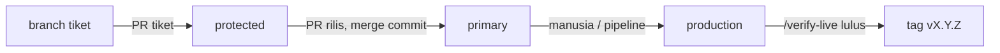

# PR/MR, merge, dan rilis

Padanan `build-release.md` di workflow Mobile. DevOps **tidak punya build**: hasil kerja adalah playbook + runbook yang lolos di staging. Hanya **Release** yang push (selain branch tiket Coder dan laporan validasi Validator), membuat PR/MR, merge PR tiket, dan membuat tag.

## PR/MR tiket
- Push hanya ke `origin`: `git push origin <branch>`.
- Tujuan: upstream `<protected>`. Hotfix → tanya user (sementara manual). `gh pr create` bila remote GitHub, `glab mr create` bila GitLab (cek `git remote get-url origin`).
- Dibuat **Draft** di awal (`/develop-tiket` langkah 4), diperbarui oleh push rutin Coder, ditandai siap di akhir (`gh pr ready <n>` / `glab mr update <n> --ready`) **hanya setelah persetujuan pemilik DevOps** (`/request-approval`).
- Judul berisi kode tiket. Isi: ringkasan, link rencana, runbook (`docs/runbooks/...`), laporan uji (`docs/tickets/<KODE>/uji.md`), Peta host, ringkasan check mode (sudah disaring `redact.sh`), hasil apply staging + idempotensi, temuan `risky-scan.sh` dan jawaban user, persetujuan (nama + waktu). Tanpa kredensial.
- Branch batch tidak pernah jadi sumber PR/MR; tiap PR/MR dari branch tiketnya sendiri.

## Merge PR tiket (`/rilis-tiket`)
Agen hanya merge PR tiket ke `<protected>` bila **semua** syarat lolos; gagal satu → lapor + saran, tidak merge.

| Syarat | Cara cek |
|---|---|
| Tiket Done dan punya PR/MR | Jira + `gh pr list` / `glab mr list` |
| PR/MR approved | `gh pr view --json reviewDecision` / `glab mr view` |
| CI hijau (lint, syntax, molecule bila ada) | status check PR/MR |
| Runbook ada dan cocok | `runbook-check.py` pada runbook + playbook di head PR |
| Persetujuan pemilik DevOps tercatat | isi PR/MR atau komentarnya |
| Diff sesuai tiket | baca diff vs AC |

Strategi merge sesuai memory project (squash atau merge commit); tidak tercatat → tanya, jangan menebak. Merge setelah user bilang "ya": `gh pr merge <n> --repo <upstream> --squash|--merge` / `glab mr merge <n>`.

## Rilis (`/branch-manager --rilis`)

- **PR rilis** `<protected>` → `<primary>` di upstream, dibuat tanpa push branch: `gh pr create --repo <upstream> --base <primary> --head <protected> --draft` / `glab mr create -R <upstream> --source-branch <protected> --target-branch <primary> --draft`. **Merge commit, bukan squash**; upstream hanya squash → berhenti dan tanya. **Di-merge manusia**, tidak pernah oleh agen.
- **Tracing:** `$AGENT_WORKFLOW_DIR/bin/release-trace.sh <primary-ref> <protected-ref> OPS ...` (TSV sha7/pr/kode/author/subject). Exit 0 = semua terlacak; 1 = ada baris tak terlacak → tandai; 2 = salah pakai/ref tidak ada; 3 = `<primary>` bukan leluhur `<protected>` (hotfix belum di-back-merge) → berhenti dan tanya.
- **Isi rilis:** semua tiket Done; commit tak terlacak ditandai; PR revert (`revert: <KODE> keluar dari rilis ...`) dan pasangan revert-dari-revert-nya dicatat "dikeluarkan".
- **Cek staging di `<sha-rilis>`** (padanan regresi beta di Mobile): worktree rilis detached, check mode tiap playbook yang tersentuh rilis ke staging (dengan kunci). Staging sudah menerima tiap tiket, jadi hasil yang diharapkan `changed=0`; selisih = drift atau interaksi antar tiket → masuk rekomendasi.
- **Runbook production:** tiap runbook yang tersentuh rilis dilengkapi `/finalize-runbook` (jendela perubahan, urutan host/batch, pelaksana, titik henti, rollback production), lalu diringkas berurutan di PR rilis.
- **Penerapan ke production** dijalankan manusia atau pipeline (memory project → Pelaksana production), **tidak pernah agen**. Agen tidak memicu pipeline (guard).
- **Setelah diterapkan:** user memberi tahu → `/verify-live` (baca saja). Lulus → tag beranotasi `vX.Y.Z` di commit merge PR rilis, push ke `upstream` dan `origin`. Gagal → tidak ada tag; lapor + langkah rollback dari runbook, tanya user. Tag tidak pernah ditimpa.
- **Keluarkan tiket dari rilis:** PR revert ke `<protected>` dari branch `revert/<KODE>-<n>` di downstream (`<n>` urut mulai 1), judul `revert: <KODE> keluar dari rilis vX.Y.Z`; merge setelah "ya". Tracing diulang. Tiket itu Done lagi → PR revert-dari-revert (`unrevert/<KODE>-<n>`) dulu sebelum dihitung masuk rilis berikutnya.
- Hotfix: sementara manual dengan bertanya (`--hotfix` belum ada).

## Jira
Komentar (baris pertama link laporan) berisi link PR/MR; tiket digeser ke Ready To Review. Done hanya oleh kolega.
