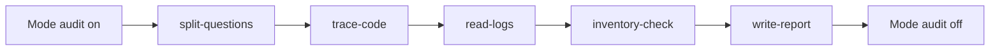

Audit permintaan di `$ARGUMENTS`: teks dalam tanda kutip, flag `--solo`/`--tim` (opsional), lalu path/link lampiran. Peranmu = **SPV audit**. Audit **hanya-baca**: tidak mengubah repo, tiket, atau host; tidak menjalankan playbook. Guard memaksanya selama mode audit menyala.

Baca dulu (jangan disalin ke sini): `~/.agent-workflow/devops/skills/_shared/rules.md`, `ticket-platform.md`, `infra.md`, `credentials.md`, `report-format.md` (→ Laporan audit), `docs-platform.md`, dan `~/.agent-workflow/devops/agents/auditor.md`, `~/.agent-workflow/devops/agents/analis.md`. Skill set khas: `~/.agent-workflow/devops/skills/{read-logs,inventory-check}/SKILL.md`.

**Model:** `claude-opus-5-5` untuk semua peran.

## Langkah (skill set berurutan)
0. **Cek awal:**
   - `AGENT_LOCK_PID=$PPID "$AGENT_WORKFLOW_DIR/bin/audit-mode.sh" on` sebelum apa pun.
   - Slug = `<yyyymmdd-hhmm>-<3 kata pertama permintaan, huruf kecil, spasi → ->`; `mkdir -p "${TMPDIR:-/tmp}/audit/<slug>"`. Semua file kerja hanya di sana.
   - Tempat jalan: root project atau workspace domain. Baca semua lampiran (yang ditempel di chat hanya terlihat sesi ini: telaah sendiri, beri worker ringkasannya).
1. **`/split-questions`:** gejala, layanan, lingkungan (staging/production), waktu kejadian, daftar pertanyaan yang harus dijawab. Kabur → periksa dulu, lalu tanya dengan satu saran.
   - **Ref:** yang disebut permintaan; tidak ada → `git fetch upstream --tags`, lalu `upstream/<primary>` (yang berjalan di production) dan tag `vX.Y.Z` terbaru. Dibaca tanpa checkout.
2. **Kerangka laporan:** `${TMPDIR:-/tmp}/audit/<slug>/laporan.md` dengan judul `Audit — <ringkasan>`, tanggal, satu bagian `(belum diisi)` per bagian "Laporan audit". Kirim path-nya ke user.
3. **Pilih mode** (`--solo`/`--tim` memaksa; tanpa flag → satu layanan dan sempit = solo, selain itu tim).
   - **Solo:** sesi ini menjalankan `auditor.md` lalu `analis.md` sendiri.
   - **Tim:** teammate (`subagent_type: auditor` atau `analis`, `model: opus`; nama Auditor: Cecep, Dadang, Sarip; Analis: Bu Lastri bila ada lampiran). Teammate otomatis hanya-baca selama mode audit sesi ini aktif. Isi tugas: "Ikuti `~/.agent-workflow/devops/agents/auditor.md`", slug, repo + ref, inventory, pertanyaan yang ditugaskan.
4. **`/trace-code`:** `git show <ref>:<path>`, `git log <ref> -- <path>`, `git grep`, `git blame`: role, template, variabel, runbook, ADR yang terkait; perubahan terbaru di area itu (siapa, kapan, PR mana).
5. **`/read-logs`** (`~/.agent-workflow/devops/skills/read-logs/SKILL.md`): log layanan dan log run sebelumnya (run lama di `~/.agent-workflow/runs/`, log job pipeline lewat `gh run view --log` / `glab ci view` bila boleh dibaca), di sekitar waktu kejadian. Production hanya lewat sumber log/monitoring dari memory project; tidak ada → "tidak bisa diperiksa".
6. **`/inventory-check`:** inventory + variabel vs dokumen; fakta host lewat modul baca (`setup`, `service_facts`, `package_facts`, `stat`) di staging/production untuk membandingkan keadaan nyata dengan repo (drift).
7. **Simpulkan:** gabungkan `${TMPDIR:-/tmp}/audit/<slug>/*.md`. Akar masalah + keyakinan (**pasti** / **kuat** / **dugaan**), dampak, ukuran perbaikan. Klaim tanpa bukti = dugaan.
8. **`/write-report`:** isi semua bagian `laporan.md`, keluaran log/host lewat `redact.sh`, tambah saran tiket (tidak dibuat).
9. **Bersihkan & ringkas:** hentikan semua teammate, lalu `AGENT_LOCK_PID=$PPID "$AGENT_WORKFLOW_DIR/bin/audit-mode.sh" off` sebagai panggilan Bash tersendiri. Di chat: path laporan + satu kalimat kesimpulan + tawaran: "simpan ke `docs/audit/<slug>.md` lewat PR docs?" Ya → worktree sementara sejajar checkout `git -C <checkout> worktree add ../<repo>-audit-<yyyymmddhhmm> -b docs/audit-<slug> upstream/<protected>`, salin laporan ke `docs/audit/<slug>.md`, commit, `git push -u origin docs/audit-<slug>`, Draft PR/MR ke `<protected>` (`docs-platform.md`), lalu `git worktree remove ../<repo>-audit-<yyyymmddhhmm>` (tanpa `--force`).

## Berhenti lebih awal / galat
Sebelum berhenti: hentikan semua teammate, isi bagian laporan yang sudah ada temuannya dan tandai sisanya belum selesai, lalu `audit-mode.sh off`.

## Tidak pernah
- Membuat, mengedit, mengomentari, atau memindah tiket; menulis Confluence.
- Commit, checkout, branch, worktree, PR/MR, edit file repo, atau menulis lewat shell (guard tidak menangkap `sed -i`/`>`) selama mode audit.
- `ansible-playbook` selain `--syntax-check`/`--list-*`, ad-hoc selain modul baca, `ansible-vault`, `molecule`, `ssh` ke host production, memicu pipeline.
