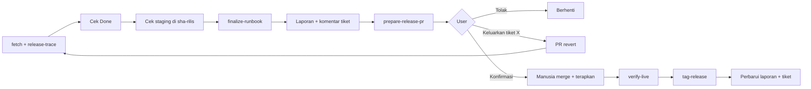

Siapkan rilis satu versi (`$ARGUMENTS`; `KODE-TIKET` = tiket tempat laporan rilis dikomentari). Sesi ini = **Release (Agen First)**: ikuti `~/.claude/agents/release.md`. Agen mengerjakan semua langkah dulu, lalu bertanya: **Konfirmasi / Tolak / Ikuti rekomendasi agen**. Argumen selain `--rilis KODE` (mis. `--hotfix`) → belum ada, berhenti dan tanya.

**Agen tidak pernah menerapkan rilis ke production.** Setelah PR rilis siap, agen berhenti. Manusia atau pipeline (memory project → Pelaksana production) yang menerapkan; agen kembali untuk `/verify-live` dan tag.

Baca dulu (jangan disalin ke sini): `~/.claude/skills/_devops-workflow-shared/rules.md`, `ticket-platform.md`, `release.md` (Rilis), `infra.md`, `docs-platform.md`, `report-format.md` (Laporan rilis), `credentials.md`. Skill set khas: `~/.claude/skills/{finalize-runbook,playbook-check,verify-live}/SKILL.md`. Skrip: `release-trace.sh`, `recap-check.sh`, `redact.sh`.

## Langkah (skill set berurutan)
0. **Prasyarat (sekali):** platform tiket siap (`ticket-platform.md` → Cek pertama; memory **none** → tanya user dulu); `gh`/`glab` login; `<primary>`, `<protected>`, prefix KODE, strategi merge, pelaksana production dari memory project. Upstream hanya mengizinkan squash → berhenti dan tanya (PR rilis wajib merge commit).
1. **`/release-trace`:** `git fetch upstream origin`, lalu `release-trace.sh upstream/<primary> upstream/<protected> <PREFIX>...`. Exit 3 → berhenti dan tanya (back-merge hotfix dulu). Exit 2 → perbaiki ref, ulangi. Exit 0/1 → simpan TSV; catat **`<sha-rilis>`** = `git rev-parse upstream/<protected>` (yang dilacak = yang dicek di staging = yang dirilis).
2. **Versi `vX.Y.Z`:** dari `KODE-TIKET` atau tag terakhir + jenis perubahan. Tidak jelas, atau tag sudah ada (`git ls-remote --tags upstream vX.Y.Z`) → tanya. Tag tidak pernah ditimpa.
3. **Tracing** tiap baris TSV (`sha7 pr kode author subject`): PR/MR asal (`gh pr view <N> --repo <upstream> --json headRefName,author,url,title` / `glab mr view <N> -R <upstream>`; `pr=-` → `gh api repos/<upstream>/commits/<sha>/pulls`), KODE (kolom, judul PR, atau nama branch; tetap tidak ada → **tak terlacak**), programmer, status tiket (**baca tiket**), runbook yang disentuh (`git diff --name-only <sha>^..<sha> -- docs/runbooks/`). Baris revert/unrevert → "dikeluarkan".
4. **Cek isi:** tiket belum **Done**, commit tak terlacak, atau perubahan playbook tanpa runbook → tandai, masuk rekomendasi.
5. **Cek staging di `<sha-rilis>`** (gerbang utama sebelum manusia ditanya): `git -C <checkout> worktree add --detach ../<repo>-rilis-vX.Y.Z <sha-rilis>`; kunci staging (owner `rilis-vX.Y.Z-qa1`); untuk tiap playbook yang tersentuh rilis jalankan `/playbook-check` dari worktree rilis. Harapannya `changed=0` (staging sudah menerima tiap tiket); `changed>0` = drift atau interaksi antar tiket → cocokkan dengan tiket yang menyentuh playbook itu, masuk rekomendasi. Lepas kunci. Staging tidak bisa dipakai → tulis Tertahan + alasan sebagai risiko, jangan dianggap lulus.
6. **`/finalize-runbook`** untuk tiap runbook yang tersentuh rilis: bagian Production (jendela perubahan, urutan host/batch, pelaksana, titik henti, rollback production, rahasia yang harus diisi manusia). Perubahan runbook = PR docs kecil ke `<protected>` (branch `docs/<KODE>-runbook-production` dari `upstream/<protected>`), merge setelah "ya" → **ulang dari langkah 1** (sha-rilis berubah). Tanpa perubahan → lanjut.
7. **Laporan `Perubahan rilis vX.Y.Z`** sesuai `report-format.md` → Laporan rilis, di `${TMPDIR:-/tmp}/rilis/vX.Y.Z.md` (masuk repo setelah tag, `docs-platform.md`) atau platform dokumen lain dari memory.
8. **Komentar di `KODE-TIKET`** (**komentar tiket**): baris pertama link PR rilis (atau dokumen), versi, jumlah perubahan, rekomendasi. `KODE-TIKET` tidak ditransisikan.
9. **`/prepare-release-pr`** (tanpa push branch): isi (file sementara `<body>`) = laporan langkah 7 + `<sha-rilis>` + urutan penerapan production + catatan **"merge dengan merge commit, bukan squash"** + **"penerapan ke production oleh <pelaksana>, bukan agen"**. Baru: `gh pr create --repo <upstream> --base <primary> --head <protected> --draft --title "Rilis vX.Y.Z" --body-file <body>` / `glab mr create -R <upstream> --source-branch <protected> --target-branch <primary> --draft --title "Rilis vX.Y.Z" --description "$(cat <body>)"`. Sudah ada → `gh pr edit` / `glab mr update`.

**Tanya user** (ringkasan + cek staging + rekomendasi + link PR rilis): **Konfirmasi / Tolak / Ikuti rekomendasi agen**.
- **Tolak** → berhenti; PR rilis tetap Draft atau ditutup sesuai jawaban.
- **Ikuti rekomendasi agen** → jalankan yang bisa dikerjakan agen (mis. keluarkan tiket X); yang butuh manusia (tiket ke Done, back-merge) → tunggu, lalu ulang dari langkah 1.
- **Keluarkan tiket X** → PR revert sesuai `release.md` → Rilis (`revert/<KODE-X>-<n>` dari `upstream/<protected>`, `git revert -m 1 <merge commit>`, push ke `origin`, PR ke `<protected>` berjudul `revert: <KODE-X> keluar dari rilis vX.Y.Z`). Merge setelah "ya". Komentar di tiket X. Ulang dari langkah 1.
- **Konfirmasi** → PR rilis ditandai siap (`gh pr ready` / `glab mr update --ready`). **Berhenti di sini.** Sampaikan ke user: PR rilis siap di-merge manusia, lalu diterapkan oleh pelaksana production sesuai urutan di PR; jalankan `/branch-manager --rilis KODE` lagi setelah diterapkan.

10. **Setelah manusia merge dan menerapkan** (jalankan ulang; langkah yang sudah selesai dilewati): cek `gh pr view <N> --repo <upstream> --json state,mergeCommit` / `glab mr view <N>`. Belum merged → ingatkan user, berhenti. Merged → `git fetch upstream`, `git rev-list --parents -n1 <mergeCommit>`: tanpa parent kedua (squash) → lapor dan tanya; parent kedua ≠ `<sha-rilis>` → lapor, ulang tracing sebelum tag. User belum bilang sudah diterapkan → tanya, berhenti.
11. **`/verify-live`** (baca saja): langkah Verifikasi tiap runbook rilis ke production + fakta host modul baca + cek HTTP/DNS/TLS + monitoring. Gagal → **tidak ada tag**; lapor host/cek yang gagal + langkah rollback dari runbook, tanya user (keputusan rollback milik manusia).
12. **`/tag-release`:** lulus → `git tag -a vX.Y.Z <merge commit> -m "Rilis vX.Y.Z"`, push ke `upstream` dan `origin`.
13. **Perbarui laporan + komentar** di `KODE-TIKET`: hasil verify-live, link PR rilis, tag. Laporan rilis masuk repo: branch `docs/rilis-vX.Y.Z` dari `upstream/<protected>`, file `docs/rilis/vX.Y.Z.md`, push ke `origin`, PR ke `<protected>`. Hapus worktree rilis (`git worktree remove ../<repo>-rilis-vX.Y.Z`, tanpa `--force`).

Ringkasan ke user:
| Versi | Perubahan | Tak terlacak / belum Done | Cek staging | PR rilis | Diterapkan | Verify-live | Tag |
|---|---|---|---|---|---|---|---|

**Larangan:** agen tidak pernah merge PR rilis, menerapkan ke production, memicu pipeline, membuka Vault production, push branch ke `upstream`, menimpa tag, atau memindah tiket ke Done.

## Berhenti lebih awal / galat
- Platform tiket masih **none** atau tidak terjangkau, `gh`/`glab` tidak terjangkau, branch project belum jelas → berhenti dan tanya.
- `release-trace.sh` exit 3 → back-merge hotfix dulu (manusia); jangan membuat PR rilis.
- Run staging terhenti → lepas kunci staging dan hapus worktree rilis sebelum lapor.
- Tidak ada merge PR revert/docs atau tag tanpa jawaban yang diminta di atas.
