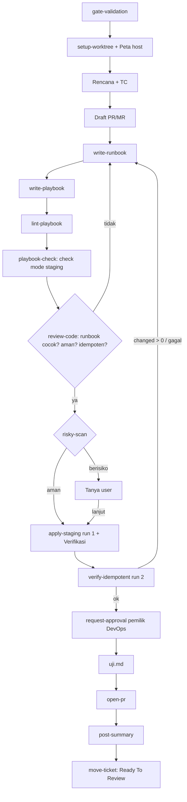

Kerjakan satu atau lebih tiket infrastruktur (`$ARGUMENTS`). Sesi ini = **SPV**: ikuti `~/.claude/agents/spv.md` (tidak menulis runbook/playbook, tidak memindah ke Done, tidak menerapkan ke production).

Baca dulu (jangan disalin ke sini): `~/.claude/skills/_devops-workflow-shared/rules.md`, `ticket-platform.md`, `infra.md`, `credentials.md`, `docs-platform.md`, `release.md`, `report-format.md`, serta `~/.claude/agents/{coder,reviewer,qa,release}.md`. Skill set khas (dijalankan peran yang disebut): `~/.claude/skills/{write-runbook,write-playbook,lint-playbook,playbook-check,apply-staging,verify-idempotent,request-approval}/SKILL.md`. Skrip: `$AGENT_WORKFLOW_DIR/bin/<skrip>`. Setiap panggilan `lock.sh` diawali `AGENT_LOCK_PID=$PPID` di panggilan Bash yang sama.

**Alur** (`--batch` default; terpisah dari `--solo`/`--tim`):
- **`--batch`:** semua tiket satu batch: satu rencana, satu branch batch, **satu rangkaian staging** (apply 1 + verifikasi + apply 2 dari branch batch). Titik tunggu di langkah 9 dan 12.
- **`--separate`:** tiap tiket jalur sendiri, apply staging dari worktree tiketnya; tetap antre kunci staging.
- **`--uat`:** sesudah QA lulus, pemilik DevOps memeriksa sendiri hasil di staging; SPV memegang kunci staging `human-<KODE>` supaya tidak ada agen yang mengubahnya (langkah 10b).

## Langkah
0. **Guard:** kenali domain (`rules.md` → Workspace & worktree). Root project atau tidak ketemu → berhenti: "Jalankan dari workspace domain". Tentukan checkout domain, kunci `checkout:<path>`. Branch batch (`--batch`) = branch checkout domain (lokal saja, **tidak pernah** di-push).
1. **Prasyarat (sekali):** platform tiket siap (`ticket-platform.md` → Cek pertama; memory **none** → tanya user dulu); `ticket-transitions.json` punya id **Ready To Review**; `ansible-inventories.json` punya entri repo (`infra.md` → Setup inventory); password Vault staging ditemukan (`credentials.md`; tidak ada → berhenti & tanya); `ansible-playbook` dan `ansible-lint` tersedia (`--version`); Molecule dicatat ada/tidak. **Sinkron sumber** sama dengan `/validate-tiket` langkah 4; catat ref.
2. **`/gate-validation`:** baca tiket + komentar + terkait/blocking; jenis tiket → `<base>` (`rules.md`). Cari laporan validasi terbaru (baris pertama komentar = link) dan **baca**:
   | Kondisi | Tindakan |
   |---|---|
   | Belum pernah divalidasi | Tanya user: `/validate-tiket` dulu, atau lanjut dengan cek singkat SPV (dicatat di rencana) |
   | **Tidak layak** | Berhenti & tanya |
   | **Layak dengan catatan** | Tiap catatan jadi TC atau tugas |
   | **Layak** | Lanjut |
   **Jejak pengerjaan** (deteksi seperti `/validate-tiket` langkah 3): wajib baca komentar review manusia (PR/MR + tiket) sejak putaran terakhir → daftar **Yang ditolak**. PR/MR merged → branch `<jenis>/<KODE>-r<n>` + Draft baru yang menyebut yang lama.
   **Acuan tiket** = link/path + ref: laporan validasi, runbook dan ADR terkait, inventory + `group_vars` yang tersentuh, role terkait. Dokumen berubah sejak validasi dan menyentuh AC → sebut bedanya, tanya user.
3. **`/setup-worktree` + Peta host** (sebelum rencana):
   - **Mode:** `--solo`/`--tim` memaksa; tanpa flag → 1 tiket kecil = solo, selain itu tim.
   - **Worktree tiket** `<repo>-<nomor>` sejajar checkout domain dari `<base>` ref remote terbaru (sudah ada dari laporan validasi atau jejak → pakai; tertinggal → tanya rebase/merge). Base + hash dicatat.
   - **Peta host:** dari `ansible-inventory -i <inventory> --graph` (staging dan production), grup yang akan disentuh tiket → host staging → jumlah host production → catatan (host staging hilang, beda OS/versi lewat modul baca `setup`). Grup tanpa host staging → TC terkait **Tertahan** sejak awal; staging tidak mewakili production → tanya user.
4. **Rencana + TC, bagi kerja, Draft PR/MR.**
   - **Rencana** (platform dokumen, atau bagian atas `docs/tickets/<KODE>/uji.md` di branch tiket bila platform `repo`): tujuan + AC, pendekatan, **runbook yang akan ditulis/diubah**, tugas bernomor (role/file per coder), Peta host, TC per AC (alat: lint / syntax / molecule / check mode / apply / idempotensi / verifikasi / rollback), risiko untuk Reviewer, di luar scope. **Tim:** SPV memanggil **Planner** (`planner.md`); periksa rencananya terhadap kunci staging dan batch. **Solo:** SPV menulis sendiri, singkat.
   - **Revisi (ada jejak):** bagian **Yang ditolak**, tiap poin jadi tugas/TC. PR/MR yang ada kembali ke Draft (`gh pr ready <n> --undo` / `glab mr update <n> --draft`).
   - **Draft PR/MR per tiket (Release), sebelum Coder mulai:** branch belum beda dari base → `git commit --allow-empty -m "chore: <KODE> mulai pengerjaan"`; `git push -u origin <branch>`; `gh pr create --draft` / `glab mr create --draft` ke `<protected>`. Isi: link rencana, Acuan tiket, Peta host.
   - **Solo:** SPV menjalankan peran Coder → Reviewer (review diri sendiri dengan daftar cek `reviewer.md`, catat bahwa review bukan independen) → QA → Release, berurutan.
   - **Tim:** teammate (tool Agent, `name: "<Nama>-<Label><n>"`, `subagent_type`, `model`):
     | Peran | Model | Catatan |
     |---|---|---|
     | Planner | `claude-fable-5-2` (jangan isi `model`) | langkah 4 dan eskalasi; berhenti setelah membalas |
     | Coder | `claude-sonnet-5-5` | di worktree tiketnya; coder ke-2+ di tiket yang sama hanya bila role/file terpisah |
     | Reviewer | `claude-opus-5-5` | bukan coder tiket itu |
     | QA (1-2) | `claude-sonnet-5-5` | apply staging antre satu kunci; QA ke-2 hanya bila ada inventory staging kedua |
     | Release | `claude-haiku-5-5` | |
     Isi tugas: "Ikuti `~/.claude/agents/<peran>.md`", KODE, AC/TC, branch, worktree, batas file, inventory staging + nama kunci, folder `${TMPDIR:-/tmp}/qa/<KODE>/`.
5. **Runbook dulu (Coder, `/write-runbook`):** runbook di `docs/runbooks/<nama>.md` dari `templates/runbook.md`, commit pertama `docs: <KODE> runbook <nama>`, push. Coder mengirim ringkasan runbook ke SPV; SPV mencocokkan dengan AC dan Peta host sebelum playbook ditulis (tidak cocok → revisi runbook).
6. **Playbook mengikuti runbook (Coder):** `/write-playbook` (tiap langkah runbook → task bernama sama), `/lint-playbook` (`ansible-lint`, `--syntax-check`, `molecule test` bila ada), `/playbook-check` (check mode + diff ke staging dengan kunci; log disaring). Commit kecil menyebut KODE, push rutin ke `origin <branch tiket>`.
7. **`/review-code` (Reviewer):** prioritas (1) **runbook ↔ playbook** (`runbook-check.py`: lima bagian, tiap task punya langkah dan sebaliknya; tidak ada playbook tanpa runbook di PR yang sama); (2) **keamanan + idempotensi** (rahasia di repo/log, `no_log`, hak akses file, `become`, `command`/`shell` tanpa `creates`/`changed_when`, handler vs restart langsung); (3) **logika vs AC** + diff check mode masuk akal. Review di PR/MR, satu komentar per putaran. Temuan wajib → kembali ke langkah 5/6. Lewat 2 putaran (tim) → Planner analisis akar masalah.
8. **Area berisiko:** `risky-scan.sh <base> HEAD` di worktree tiket. Exit 1 → SPV **berhenti dan bertanya** ke user (daftar baris + host terdampak + rollback dari runbook) sebelum apply. Jawaban dicatat untuk `uji.md` dan PR.
9. **Branch batch** (`--batch`; `--separate` lewati): di checkout domain, `git merge --no-ff <branch tiket>` untuk tiap tiket yang lolos review dan langkah 8. **Titik tunggu:** apply staging hanya setelah semua tiket siap atau dikeluarkan (alasan di rencana). Konflik → berhenti dan tanya.
10. **Staging (QA):** `/apply-staging` (kunci staging, run 1 → `recap-check.sh`, langkah Verifikasi runbook) lalu `/verify-idempotent` (run 2 → `recap-check.sh --idempotent`); uji rollback bila ada TC-nya. Laporan `${TMPDIR:-/tmp}/qa/<KODE>/report.md`. Gagal / `changed>0` di run 2 → kembali ke langkah 6 (Coder) → review → staging lagi.
10b. **`--uat`:** QA melepas kuncinya; SPV `AGENT_LOCK_PID=$PPID lock.sh acquire staging:<repo>/<inv> human-<KODE>`, beri tahu user: inventory, host, yang berubah, langkah Verifikasi, dan "bilang *selesai UAT* bila sudah". User selesai → `release`. Temuan user → kembali ke langkah 6.
11. **`/request-approval` (SPV):** ringkasan persetujuan (`report-format.md`) sebagai komentar PR/MR + pesan chat untuk pemilik DevOps (memory project). **Tunggu jawaban manusia**: "setuju" → catat nama + waktu; "tolak" → poinnya jadi Yang ditolak, kembali ke langkah 5/6. Tanpa jawaban → PR/MR tetap Draft.
12. **Putuskan selesai** per tiket hanya bila: runbook cocok, semua TC **Lulus** atau **Tertahan** beralasan, review tanpa temuan wajib, run 2 `changed=0`, persetujuan tercatat. `--batch`: perbaikan dikumpulkan lalu satu rangkaian staging ulang; tiket macet dikeluarkan dari batch dan dilaporkan.
13. **Laporan:** SPV menulis `docs/tickets/<KODE>/uji.md` di worktree tiket (`report-format.md` → Laporan uji; keluaran disaring `redact.sh`), commit `docs: <KODE> laporan uji`.
14. **`/open-pr` (Release):** `git push origin <branch tiket>`, perbarui isi Draft PR/MR (`release.md` → PR/MR tiket), tandai siap (`gh pr ready <n>` / `glab mr update <n> --ready`).
15. **`/post-summary` (Release):** komentar tiket: baris pertama link `uji.md`, lalu runbook, PR/MR, persetujuan, catatan bahwa production diterapkan manusia/pipeline saat rilis.
16. **`/move-ticket` (Release):** **geser status** ke Ready To Review. Tidak pernah Done.
17. **Bersihkan & ringkas:** hapus worktree tiket buatan batch ini yang sudah Ready To Review (syarat `rules.md`), `molecule destroy` untuk scenario yang dipakai, hentikan semua teammate, pastikan semua kunci (`staging:*`, `checkout:*`, `human-*`) dilepas.

   | KODE | Status | Runbook | Laporan uji | PR/MR |
   |---|---|---|---|---|

## Berhenti lebih awal / galat
Sebelum berhenti (guard, tanya, galat, user membatalkan): lepas semua kunci batch ini (`AGENT_LOCK_PID=$PPID "$AGENT_WORKFLOW_DIR/bin/lock.sh" release <resource> <owner>`), minta teammate melakukan hal sama lalu hentikan mereka, laporkan posisi terakhir per tiket. Run staging terhenti di tengah → catat host + task terakhir dari log; staging mungkin setengah berubah → sebut di laporan dan tanya user apakah rollback runbook dijalankan di staging.

## Tidak pernah
- `ansible-playbook` / Vault / ad-hoc non-baca ke production; memicu pipeline; `ssh` ke host production.
- Menandai PR/MR siap review tanpa persetujuan pemilik DevOps.
- Apply ke staging tanpa kunci, atau sebelum review dan langkah 8 selesai.
