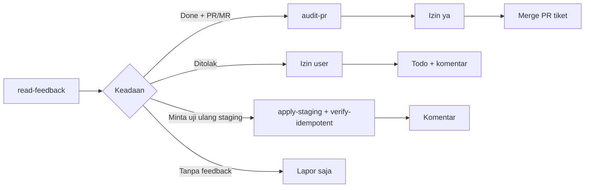

Tindak lanjuti feedback untuk satu atau lebih tiket (`$ARGUMENTS`). Sesi ini = **Release**: ikuti `~/.agent-workflow/devops/agents/release.md`. Keputusan (izin Todo, izin merge) ke user lewat chat: ringkasan + satu saran. Rilis per versi (PR rilis, verifikasi production, tag) bukan di sini: itu `/branch-manager --rilis`.

Baca dulu (jangan disalin ke sini): `~/.agent-workflow/devops/skills/_shared/rules.md`, `ticket-platform.md`, `release.md` (Merge PR tiket), `infra.md`, `report-format.md`, `credentials.md`. Remote: `origin` = fork, `upstream` = repo utama.

## Langkah (skill set berurutan)
0. **Prasyarat (sekali):** platform tiket siap (`ticket-platform.md` → Cek pertama; memory **none** → tanya user dulu); `ticket-transitions.json` punya id **Todo**; `<primary>`/`<protected>` dan strategi merge PR tiket dari memory project (`rules.md` → Lokasi). `git fetch upstream origin`.
1. **`/read-feedback`** per tiket: **baca tiket** + komentar (status Ready To Review/Done; lainnya → lapor dan lewati), PR/MR-nya (`gh pr list --search <KODE>` / `glab mr list`) + komentar review. **Feedback terakhir** = komentar manusia terbaru (tiket + PR/MR) setelah komentar agen terakhir.
2. **Pilih tindakan:**
   | Keadaan | Tindakan |
   |---|---|
   | Ditolak | 3a |
   | Positif, belum Done, diminta uji ulang di staging (mis. staging di-reset, drift) | 3b |
   | Done + punya PR/MR | 3c |
   | Positif tanpa permintaan (belum Done) / tanpa feedback | Lapor saja |
   Beberapa keadaan sekaligus → urutan **Done > ditolak > uji ulang**. Feedback bertentangan → tanya user.
3. **Tindakan:**
   - **3a Ditolak:** ringkas arahan (apa, dari siapa, di mana). Minta izin user; "ya" → **geser status** ke **Todo** + komentar ringkasan (baris pertama link PR/MR). Putaran berikutnya lewat `/validate-tiket` lalu `/develop-tiket`.
   - **3b Uji ulang di staging:** worktree tiket `<repo>-<nomor>` (sudah dihapus → `git fetch origin`, buat ulang sejajar checkout domain dari `origin/<branch tiket>`; branch lokal sudah ada → tanpa `-b`, lalu `git merge --ff-only origin/<branch>`; tidak bisa fast-forward → berhenti dan tanya). Jalankan `/apply-staging` lalu `/verify-idempotent` (`~/.agent-workflow/devops/skills/{apply-staging,verify-idempotent}/SKILL.md`) dengan kunci staging. Perbarui `docs/tickets/<KODE>/uji.md` (commit + push ke branch tiket), komentar tiket (baris pertama link `uji.md`). Hapus worktree lagi bila bersih dan sudah di-push.
   - **3c Done → `/audit-pr`:** audit sesuai tabel `release.md` → Merge PR tiket (approved, CI hijau, runbook cocok lewat `runbook-check.py` di head PR, persetujuan pemilik DevOps tercatat, diff sesuai tiket).
     - Cek PR revert: `gh pr list --repo <upstream> --state merged --limit 200 --json headRefName --jq '.[].headRefName' | grep -E '^(un)?revert/<KODE>-[0-9]+$'` (GitLab: `glab mr list --merged -F json`, `source_branch`). Ada `revert/<KODE>-<n>` tanpa pasangan `unrevert/<KODE>-<n>` → PR revert-dari-revert dulu (`release.md` → Rilis), merge setelah "ya".
     - Lolos → minta "ya" user, lalu merge (`gh pr merge <n> --repo <upstream> --squash|--merge` / `glab mr merge <n>`, strategi dari memory). Gagal satu syarat → lapor + saran, tidak merge. Komentar tiket (link PR + commit merge).
4. **Ringkasan:**
   | KODE | Feedback | Tindakan | PR/MR | Status |
   |---|---|---|---|---|

Agen tidak pernah memindah tiket ke Done, tidak pernah merge PR rilis ke `<primary>`, dan tidak pernah menerapkan ke production.

## Berhenti lebih awal / galat
- Platform tiket masih **none** atau tidak terjangkau, `gh`/`glab` tidak terjangkau, id Todo belum ada → berhenti dan tanya.
- Run staging terhenti → lepas kunci staging sebelum lapor; catat host + task terakhir.
- Tidak ada merge tanpa jawaban "ya".
