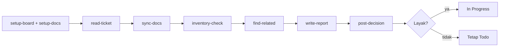

Validasi satu atau lebih tiket infrastruktur (`$ARGUMENTS`). Peranmu = **Validator**; di mode tim kamu juga **SPV** validasi. Tidak menulis playbook/runbook, tidak memindah tiket ke Done, tidak menerapkan apa pun ke host.

Baca dulu (jangan disalin ke sini): `~/.agent-workflow/devops/skills/_shared/rules.md`, `ticket-platform.md`, `infra.md`, `credentials.md`, `docs-platform.md`, `report-format.md`, dan `~/.agent-workflow/devops/agents/validator.md`; mode tim juga `~/.agent-workflow/devops/agents/{hoe,pjm,eskalasi}.md`. Skill set khas: `~/.agent-workflow/devops/skills/inventory-check/SKILL.md`. Skrip: `$AGENT_WORKFLOW_DIR/bin/<skrip>` (`AGENT_WORKFLOW_DIR` seperti di `rules.md`).

**Mode:** sesi ini bertindak langsung sebagai Validator/SPV (bukan subagen `validator`), supaya akses platform tiket dan dokumen di satu tempat. Tiket berurutan.
- `--solo` (atau tanpa flag untuk tiket kecil/jelas, satu layanan): sesi ini mengerjakan semua langkah.
- `--tim` (tanpa flag: tiket yang menyentuh banyak grup host, jaringan/akses, data, atau high-risk): langkah 5 dibagi ke teammate.

## Langkah (skill set berurutan)
1. **`/setup-board`** (sekali): ikuti `~/.agent-workflow/devops/skills/_shared/ticket-platform.md`.
   - Memory project → **Platform tiket** = **none** → **berhenti dan tanya user dulu** (Jira / GitHub Issues + Projects / GitLab Issues + board / manual / belum tahu). Belum tahu → sarankan GitHub Projects atau GitLab issue board sesuai host `git remote get-url origin`. Simpan jawaban + lokasi + prefix KODE.
   - **Cek akses** platform itu; gagal → berhenti, lapor cara memperbaikinya.
   - `ticket-transitions.json` belum punya entri project → "Setup status" (papan belum ada → tawarkan membuatnya, hanya setelah user bilang ya). Manual → lewati.
2. **`/setup-docs`** (sekali per repo): platform dokumentasi dari memory project (`docs-platform.md`; belum ada → tanya dengan saran `repo`, simpan). `ansible-inventories.json` punya entri repo; belum → "Setup inventory" di `infra.md`. Memory project lain yang dibutuhkan (branch project, Vault staging, pemilik DevOps, pelaksana production) dicatat bila belum ada.
3. **`/read-ticket`** per tiket: tiket + komentar + link (**baca tiket**). Catat AC, layanan, lingkungan yang disebut, dan jenis (hotfix / feature / fix / chore).
   **Deteksi jejak:** PR/MR (`gh pr list --state all --search <KODE>` / `glab mr list --all --search <KODE>`), komentar tiket berisi laporan uji/rencana agen, atau branch `origin/*/<KODE>(-r<n>)?` (tanpa `revert/`/`unrevert/`) yang mengubah file di luar `docs/tickets/<KODE>/` (`git diff --name-only <base>...origin/<branch>`). Ada → **validasi ulang**: baca penolakan sejak putaran terakhir (komentar arahan QA dari `/rilis-tiket` + review PR/MR manusia), golongkan:
   | Golongan | Tindakan |
   |---|---|
   | **Implementasi meleset** (requirement tetap) | **Layak**; daftar revisi masuk "Yang ditolak" |
   | **Requirement berubah/kurang** | Cek ulang dokumen + inventory; tidak jelas → tanya user/PM; keputusan memakai "Aturan keputusan" |
   Jejak ada tanpa komentar penolakan → tanya user apa yang ditolak. PR/MR sudah merged → putaran baru di branch `<jenis>/<KODE>-r<n>`.
4. **`/sync-docs`** (sekali per sesi): `git fetch upstream`, baca dari `upstream/<protected>` tanpa checkout: `docs/runbooks/`, `docs/adr/`, inventory, `group_vars`/`host_vars`, role terkait. Platform dokumen lain → ambil versi terbaru. Catat ref yang dibaca.
5. **`/inventory-check`** (skill set khas): bandingkan permintaan dengan inventory, variabel, dan dokumen; host/grup yang disebut tiket ada di staging dan production; layanan dan versi sekarang lewat modul baca (`setup`, `service_facts`, `package_facts`) bila perlu. **Bug** (layanan salah konfigurasi, error di host): kumpulkan bukti baca saja dengan `/read-logs` (`~/.agent-workflow/devops/skills/read-logs/SKILL.md`) dan fakta host; tidak ada perubahan apa pun.
   Nilai dampak: host terdampak, layanan, area berisiko (hapus data, restart, firewall/akses), ukuran pekerjaan, dan apakah staging cukup mirip production untuk diuji.
6. **`/find-related`**: tiket Todo/In Progress yang tidak di-link tapi menyentuh grup host, role, layanan, atau variabel yang sama (**cari tiket**), PR/MR terbuka di file yang sama, kunci staging yang sedang dipegang (`lock.sh who staging:<repo>/<inv>`). Link antar tiket tidak dibuat; cukup disarankan.
   **Aturan keputusan:**
   | Kondisi | Keputusan | Tindakan |
   |---|---|---|
   | Informasi minim, AC inti jelas | Layak dengan catatan | Pertanyaan di komentar untuk reporter |
   | Informasi minim, AC inti kabur | Tidak layak | Tetap Todo; daftar yang harus dilengkapi |
   | Host/grup yang diminta tidak ada di inventory | Tidak layak sampai jelas | Sebut host/grup + inventory yang dicek |
   | Staging tidak bisa mewakili production untuk perubahan ini | Layak dengan catatan | Risiko ditulis; jadi TC Tertahan atau uji tambahan |
   | Bertabrakan dengan tiket/dokumen lain | Tidak layak sampai diputuskan | Kedua tiket + titik tabrakan; tanya user |
   | Tumpang tindih tapi selaras | Layak dengan catatan | Saran urutan/penggabungan |
7. **`/write-report`**: laporan validasi sesuai `report-format.md`, diterbitkan sesuai `docs-platform.md`. Platform `repo`: worktree tiket `<repo>-<nomor>` sejajar checkout (dari `<base>`, branch `<jenis>/<KODE>`; sudah ada → pakai), tulis `docs/tickets/<KODE>/validasi.md`, commit `docs: <KODE> laporan validasi`, `git push -u origin <branch>`; link = URL file di `origin`. Validasi ulang: perbarui file yang sama (Delta + Yang ditolak di atas).
8. **`/post-decision`**: **komentar tiket**: baris pertama link laporan, lalu **Layak** / **Layak dengan catatan** / **Tidak layak** + alasan (gaya humanis, `report-format.md`). Layak / Layak dengan catatan → **geser status** ke In Progress (id dari `ticket-transitions.json`). Tidak layak → tetap Todo.
9. **Mode tim** (menggantikan langkah 5–6; Validator tetap menulis laporan, komentar, transisi):
   | Peran | Model | Catatan |
   |---|---|---|
   | HoE | `claude-opus-5-5` | selalu: repo vs dokumen vs inventory, dampak host, fakta host baca saja |
   | PjM | `claude-sonnet-5-5` | selalu: tiket terkait, PR/MR terbuka, kunci staging, risiko bentrok |
   | Spesialis eskalasi | `claude-fable-5-2` (jangan isi `model`) | hanya bila: temuan HoE ambigu, tiket high-risk (data, akses/firewall, jaringan, autentikasi), atau konflik antar-agen |
   Brief: KODE, ringkasan + AC, ref dokumen, repo + inventory, folder `${TMPDIR:-/tmp}/validate/<KODE>/`. Prompt: "Ikuti `~/.agent-workflow/devops/agents/<peran>.md`". Gabungkan `${TMPDIR:-/tmp}/validate/<KODE>/*.md` jadi satu laporan. Hentikan teammate yang tugasnya habis.
10. **Ringkasan akhir:**

   | KODE | Keputusan | Laporan |
   |---|---|---|

Keputusan parsial boleh. Tidak ada `ansible-playbook` (selain `--syntax-check`) di validasi.
